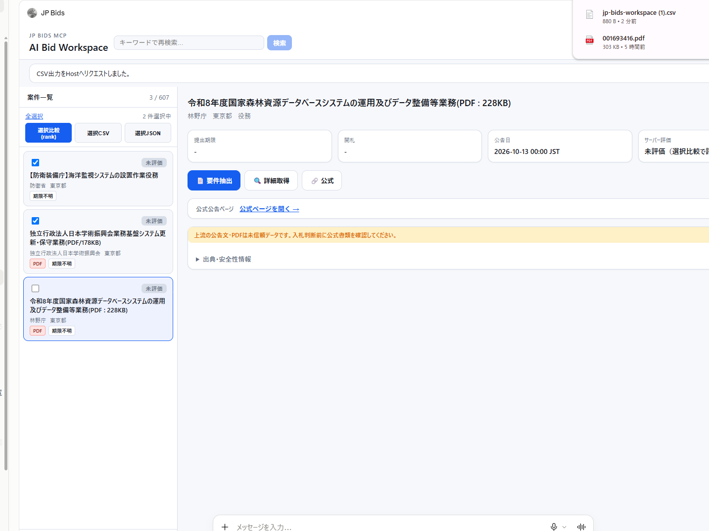

**案内予定日時：2026年10月22日 15:00 JST**

## はじめに
官公庁や自治体による公共調達（官公需入札）は、多くの事業者にとって重要な事業機会ですが、案件情報の収集や整理には日常的な確認負荷がかかります。

スグクル株式会社では、Model Context Protocol (MCP) を活用し、Claude 上で実在する入札公告の検索・詳細確認、および検討用リストのエクスポートが行える **「JP Bids MCP」** を提供しています。

本記事では、すでに稼働しているリモート接続エンドポイントを用い、Claude 上で実公告の検索からワークスペースUIを通じたCSV取得までの標準的な利用手順を解説します。

データの出典は、中小企業庁の[官公需情報ポータルサイト（KKJ）](https://www.kkj.go.jp/)です。本ツールはスグクル株式会社が提供するMCPサーバーであり、政府機関やKKJの公式製品ではありません。

## 接続設定（OAuth 2.0認可）
リモートMCP（Streamable HTTP）に対応しており、URL登録とOAuth認可を行うことで接続できます。

- **接続URL**: `https://mcp.bid-jp.com/mcp`
- **利用料金**: 無料（※Claudeの利用料金は別途発生する場合があります）
- **公式案内**: [スグクル株式会社 サービス紹介ページ](https://sugu-kuru.co.jp/services/jp-bids-mcp)

### 接続手順
1. Claude（Web版またはDesktop版）のメニューから「カスタマイズ」>「コネクタ」を開く
2. 「カスタムコネクタを追加」を選択し、接続URL `https://mcp.bid-jp.com/mcp` を入力
3. 画面の案内に従って OAuth 2.0 認可を完了する

※Claude Team または Enterprise プランをご利用の場合、ワークスペース管理者によるコネクタ追加の許可・権限設定が必要になる場合があります。詳しい追加手順や組織設定は [Anthropicヘルプセンター（カスタムコネクタの追加）](https://support.claude.com/ja/articles/11175166) をご確認ください。

## 確認済みの標準利用手順（ワークスペースと選択CSV）

Claudeの本番カスタム接続環境において、以下の操作フローで実公告の検索およびCSVエクスポートが動作することを確認しています。

### 1. 実公告の検索とワークスペース描画
チャット上で `search_bids_app` を呼び出します。例えば、以下のようにそのまま入力して試すことができます。

> **依頼例:**  
> JP Bidsの `search_bids_app` で、東京都・役務、件名に「システム」を含む公告を最大3件検索し、AI Bid Workspaceを表示してください。

実在する官公需公告が検索され、チャット内に「AI Bid Workspace」ウィジェットが表示されます。

### 2. 検討対象案件のチェック
ウィジェット内の案件一覧から、自社の関心に合う案件カードのチェックボックスを選択します。

*2026年10月21日JST確認。チェックボックスで選ぶ案件と、右側に開いている詳細は別です。画像は選択状態を示すもので、全UI操作の検証を示すものではありません。*

### 3. 「選択CSV」によるデータ取得
画面上部の **「選択CSV」** ボタンをクリックします。

今回の検証では、選択した2案件を含むCSVファイルを取得し、案件・発注機関・理由の対応を確認しました。  
（※「選択CSV」クリック後の保存・コピー動作は、ご利用のブラウザやクライアント環境の仕様に依存します。）

> 💡 **チャット直接生成との違い**:  
> チャットのプロンプト上で「CSVを出力して」と指示して会話文として再生成させた場合、AIの自然言語処理による表記ゆれが生じる可能性があります。案件Keyや発注機関名の正確な受け渡しのため、ウィジェット上の「選択CSV」ボタンからの取得を標準フローとして推奨しています。

## 業務利用にあたっての留意点
- **原本確認の原則**:  
  本ツールが提供するのは公告メタデータおよび公式資料URLの整理です。入札参加資格や提出期限等の最終確認は、必ず発注機関が提示する公式原本にて行ってください。
- **資料本文の取得・解析について**:  
  今回の本番検証では、添付資料本文の取得・解析は対象としていません（公開コードには `fetch_documents: true` による資料一時取得の抽出オプションが存在しますが、今回の検証では公告メタデータと公式原本URLの確認を対象としています）。仕様書原本の精読や提案書の作成は、発注機関の公式原本をご確認の上、Claude自身の文書理解機能や外部ツールと組み合わせて実施してください。

## おわりに
JP Bids MCP はどなたでも無料で接続いただけます。公共調達リサーチの初期確認にぜひお役立てください。
