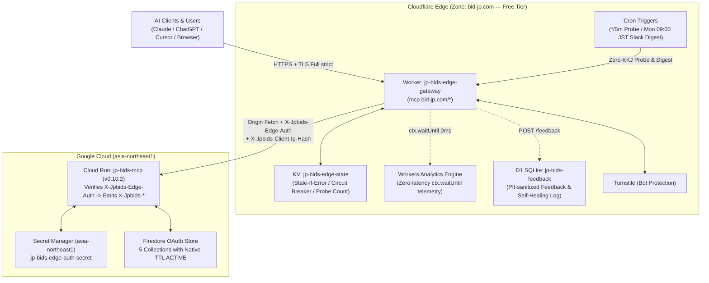

# Cloudflare × Cloud Run MCP エッジ基盤 完全ドキュメント＆他案件横展開プレイブック

**対象システム**: JP Bids MCP (`https://mcp.bid-jp.com`, `v0.10.2`)  
**カットオーバー完了日時**: `2026-11-20 04:04 JST`（`2026-11-19T19:04:15Z`）  
**状態**: **本番稼働中（Cloudflare `NRT` 東京エッジ経由・`5xx = 0`・全 E2E PASS）**

---

## 1. 本番カットオーバー（C5）実測結果サマリー

`mcp.bid-jp.com` の DNS を **Proxied（オレンジ雲）** へ切り替えた直後の全検証結果（実 KKJ API 通信 **0 回**）：

| 検証項目 | エンドポイント | ステータス | `server` / `CF-Ray` | 詳細・確認結果 |
|---|---|---|---|---|
| **ヘルスチェック** | `GET /health` | `200` | `cloudflare` / `a5d17aa30f4de09c-NRT` | 内部ヘッダ漏洩 `0` 件 |
| **レディネス** | `GET /readyz` | `200` | `cloudflare` / `a5d17aa41e15c762-NRT` | 内部ヘッダ漏洩 `0` 件 |
| **Server Card** | `GET /.well-known/mcp/server-card.json` | `200` | `cloudflare` / `a5d17aa4c85be09c-NRT` | **`version: "0.10.2"`** |
| **OpenAI ドメイン確認** | `GET /.well-known/openai-apps-challenge` | `200` | `cloudflare` / `a5d17aa568a8e09c-NRT` | 正常応答 |
| **フィードバック画面** | `GET /feedback` | `200` | `cloudflare` / `a5d17aa5d856c762-NRT` | 日英 UI ＋ Turnstile (`0x4AAAAAAGIycdeICKrOIziz`) 表示確認 |
| **OAuth 2.0 フルフロー** | `/oauth/register` → `/authorize` → `/token` | `201` → `302` → `200` | `cloudflare` / `a5d17aa6...`〜`a5d17aa9...` | クライアント IP ハッシュ分離・PKCE S256 正常 |
| **MCP `tools/list`** | `POST /mcp` (`2026-07-28`) | `200` | `cloudflare` / `a5d17aab5b92e09c-NRT` | **公開 7 ツール完全一致**・内部ヘッダ漏洩 `0` 件 |
| **MCP Apps UI 読取** | `POST /mcp` (`resources/read`) | `200` | `cloudflare` / `a5d17aabebe1e09c-NRT` | `ui://jp-bids/search-results.html` (`699,730` bytes)・漏洩 `0` 件 |
| **Cloud Run サーバーエラー** | `jp-bids-mcp-00091-jiq` | **`5xx = 0` 件** | — | 異常ログゼロ |

---

## 2. なぜこれを構築したのか（Why We Built This）

Cloud Run 単体でも MCP サーバーは動きますが、**一般公開して運用・改善し続けるフェーズ**に入ると、以下の 4 つの壁に必ずぶつかります。Cloudflare を前段に置くことで、これらを **追加インフラ月額 $0（Free 枠内）・レスポンス遅延 0ms** で一気に解決しました。



### 解決した 4 つの課題
1. **利用データの揮発解消（遅延 0ms の分析基盤）**:
   - Cloud Run は `minScale=0` でスケールインするため、メモリ上のカウンタ（`/stats`）はすぐ消えます。
   - **解決**: Cloud Run が検証済みエッジ通信にだけ非 PII の統計ヘッダ（`X-Jpbids-*`）を返し、Cloudflare Worker が読み取って `ctx.waitUntil()` で **Workers Analytics Engine** に非同期記録し、クライアントに返す直前にヘッダを削除します。応答速度への影響は **0ms**、検索クエリ等の PII 保存は **0件** です。
2. **エッジでの 3 層自己修繕（Self-Healing）**:
   - オリジン瞬断時でも `/.well-known/*`・`/health`・`/privacy`・`/terms` を KV キャッシュ（`stale-if-error`）から返却し、AI クライアントのコネクタ認証エラーを防ぎます。
   - 上流 KKJ API の 5xx が短時間に連続した場合は KV サーキットブレーカーが 30 秒間保護モードに入り、上流サーバーへの過負荷を自動遮断します。
   - 5 分ごとの Cron が **KKJ 通信 0 回** で `/readyz` と `server-card.json` を監視し、3 回連続失敗時に D1 記録＆Slack アラートを発報します。
3. **MCP Apps の厳格 CSP を破らないユーザー反応収集**:
   - MCP Apps UI は `connectDomains: []`（iframe 内からの外部 `fetch` 完全禁止）が原則です。
   - **解決**: UI からは `app.openLink({ url: "https://mcp.bid-jp.com/feedback?tool=search_bids_app" })` で外部ブラウザを開き、Cloudflare Worker が日英フィードバック画面＋Turnstile ボット防御＋JWT/APIキー/メール/電話番号の強制自動マスク＋D1 保存を完結させます。
4. **データ肥大化防止（Firestore 5 コレクション Native TTL）**:
   - 放置すると際限なく増える OAuth 関連ドキュメント（クライアント登録・認可コード・リフレッシュトークン・トークンファミリー・レート制限）すべてに Firestore Native TTL を `ACTIVE` 化し、完全自動掃除を実現しました。

---

## 3. 実戦で踏んだ 9 つの落とし穴と解決パターン（再利用時の最重要ナレッジ）

今回の構築で実際に発見・回避した **9 つの実戦ノウハウ** です。次回別のプロジェクトに導入するとき、この一覧を先にチェックすれば同じ罠を 100% 回避できます。

| # | 落とし穴（Trap） | 放置すると起きる障害 | 今回の解決パターン（Best Practice） |
|---|---|---|---|
| **1** | **Cloud Run `trust proxy: 1` × Cloudflare Proxy の OAuth 429 衝突** | Cloudflare を挟むと `X-Forwarded-For` が 2 ホップになり、Cloud Run の `req.ip` が Cloudflare PoP の IP になる。東京 PoP 経由の全ユーザーが 1 つのレート制限バケット（60 req/min）を共有して一斉 `429` になる。 | Worker が共有シークレット `X-Jpbids-Edge-Auth` と日次ソルト付きハッシュ `X-Jpbids-Client-Ip-Hash` を付与し、オリジン側が `timingSafeEqual` で検証できた場合のみハッシュをレート制限キーにする（生 IP 非保存）。 |
| **2** | **エッジでの全リクエスト自動リトライ** | `POST /oauth/token`（単一使用 Refresh Token）をエッジが 502/504 で自動再送すると、オリジン側で「トークン再利用攻撃」と誤判定され `familyId` 全体が永久失効する。`tools/call` を再送すると上流 API レート制限を破る。 | **3 クラス厳格分離**：Class A（静的/ディスカバリ：キャッシュ＋リトライ可）、Class B（`readyz` とローカル読み取り MCP メソッド：1回 250ms リトライ可）、**Class C（`/oauth/*` と `tools/call`：エッジリトライ絶対禁止）**。 |
| **3** | **Cloudflare と GCP の共有シークレット一致確認ができない問題** | どちらの画面も保存後は値を見られないため、タイポや改行混入に気づかないままカットオーバーしてしまう。 | 本番 DNS 切替前に `*.workers.dev` 経由で `resources/read` を 1 回叩き、Analytics Engine にオリジン専用ヘッダ由来の値（`blob2 = "ui://jp-bids/search-results.html"`）が入ることを確認する（**シークレット値を一切閲覧せずに一致証明**）。 |
| **4** | **初回 Git 連携時に `wrangler.toml` に本番 `routes` やダミー ID が残っている** | Cloudflare Workers Builds の初回デプロイが即座に本番ルートを奪うか、プレースホルダ ID でビルド失敗する。また、PR ブランチの `wrangler preview` が `[previews]` ブロック不足で毎回失敗する。 | ① 先に D1/KV/Turnstile を作成して実 ID を取得、② `routes` をコメントアウト＋`workers_dev = true` で PR マージ、③ Git 連携後に Dashboard で **Builds for Preview branches = Off**、④ カットオーバー直前の別 PR で `routes` を復帰。 |
| **5** | **Cloudflare Cron の曜日番号罠** | Linux cron の感覚で `0 0 * * 1` と書くと、Cloudflare（Quartz 準拠 `1=SUN, 2=MON`）では **日曜日** に実行される。 | 必ず 3 文字略称 **`0 0 * * MON`** を使い、Worker コード側も `cron === "0 0 * * MON" \|\| cron === "0 0 * * 2"` で受ける。 |
| **6** | **Cloudflare の Browser Integrity Check が MCP クライアントを誤遮断** | デフォルト ON のため、ブラウザ以外の User-Agent（`Claude-User`, `ChatGPT-User`, `Cursor`, `curl` 等）が 403 チャレンジされる恐れがある。 | ゾーンの Configuration Rule で **`mcp.bid-jp.com` のみ Browser Integrity Check = Off** に設定。 |
| **7** | **Google マネージド証明書の更新失敗＆切り戻し不能リスク** | Proxied（オレンジ雲）にすると Google の HTTP-01 証明書更新が通らず、60〜90 日後に DNS をグレー雲へ戻した際に期限切れ証明書で通信不能になる恐れがある。 | ① Worker の転送先は Google 共通証明書の `*.a.run.app`（Proxied 稼働中は 526 ゼロ）、② 切替前に現行証明書の `NotAfter`（今回は `2027-01-08`）を実測してグレー雲切り戻し可能期間を確定、③ 長期運用後の切り戻しは Cloudflare 内の Worker Rollback を使う。 |
| **8** | **PowerShell 5.1 の末尾改行混入 ＆ GCP ロケーション制約** | `$plain \| gcloud secrets create --data-file=-` は CRLF を付けてしまい一致検証が失敗する。また `automatic` は組織ポリシー `constraints/gcp.resourceLocations` で拒否される。 | `[System.IO.File]::WriteAllText($tmp, $plain, [System.Text.UTF8Encoding]::new($false))`（BOM・改行なし）＋ `--replication-policy="user-managed" --locations="asia-northeast1"` ＋ `finally` で一時ファイル即時削除。 |
| **9** | **Firestore TTL フィールドの漏れ** | 4 コレクションに `expiresAtDate` があっても、後から増やした `refresh_families` に付与し忘れるとそこだけゴミが溜まり続ける。 | 全コレクションに `expiresAtDate` / `resetAtDate` を統一付与し、`gcloud firestore fields ttls list` で全件 `ACTIVE` を確認。 |

---

## 4. 他の案件・チャンスでの再利用ガイド（How to Reuse Elsewhere）

この **「Cloudflare Edge Gateway（Workers + D1 + KV + Analytics Engine + Turnstile）＋ Cloud Run / 任意オリジン」** パターンは、JP Bids に限らず **あらゆる API / MCP / AI エージェント / SaaS** にそのまま横展開できます。

### 4.1 横展開できる具体的なユースケース
1. **別の MCP サーバー（例: 社内業務 MCP・補助金/不動産/人材データ MCP・顧客向けホワイトラベル MCP）**:
   - `workers/jp-bids-edge-gateway/` を丸ごとコピーし、`ORIGIN_URL`・`PUBLIC_BASE_URL`・`routes` の 3 行を変えるだけで、即座に「ツール別利用率分析」「0件ヒット率計測」「障害時 Stale-If-Error」「`/feedback` 窓口」「5分監視＆週次 Slack レポート」が手に入ります。
2. **課金・B2B SaaS の API ゲートウェイ（Cloud Run / Fly.io / Railway / Supabase 前段）**:
   - 同じ `X-*-Edge-Auth` + `X-*-Client-Ip-Hash` パターンで、オリジン負荷ゼロのエッジレート制限・顧客別 API 利用量メータリング（Analytics Engine）・障害時サーキットブレーカーとしてそのまま転用できます。
3. **LP・フォーム・問い合わせ窓口のボット対策＋PII 保護（月額 $0）**:
   - `/feedback` の構成（Worker HTML + Turnstile + 正規表現 PII マスク + D1 + 週次 Slack 通知）は、小規模プロダクトの β テスト反応収集やアンケート窓口にそのまま使えます。
4. **AI ディレクトリ申請（OpenAI ChatGPT Apps / Anthropic Connectors）の信頼性アピール**:
   - 「エッジ自己修繕・レート制限保護・PII 非保存テレメトリ・OAuth TTL 自動削除」まで整備済みであることは、プラットフォーム審査や法人導入のセキュリティチェックシートで強力な差別化材料になります。

### 4.2 新規プロジェクトへの導入 7 ステップ（標準テンプレート）

1. **Cloudflare リソース作成（Free 枠）**:
   - D1 DB 作成＋`0001_init.sql` 適用、KV Namespace 作成、Analytics Engine 有効化、Turnstile Widget（Managed）作成。
2. **ステージング用 `wrangler.toml` PR**:
   - 実 ID を埋め込み、`workers_dev = true`、**本番 `routes` はコメントアウト**、Cron 曜日は `MON` 等の 3 文字表記で PR マージ。
3. **Cloudflare Workers Git 連携**:
   - Root directory 指定で接続・初回デプロイ。直後に **Settings → Builds → Builds for Preview branches = Off** に設定。
4. **シークレット登録（両サイド）**:
   - Cloudflare Production Secrets に `EDGE_AUTH_SECRET`, `IP_HASH_SALT`, `TURNSTILE_SECRET_KEY`（＋任意で `SLACK_BOT_TOKEN`, `SLACK_CHANNEL_ID`）を登録して **Deploy → Save**。
   - オリジン側（GCP Secret Manager 等）に同じ `EDGE_AUTH_SECRET` を BOM/改行なしで登録し、実行サービスアカウントへ読取権限付与。
5. **オリジン配備（0% → 100%）＆無閲覧シークレット一致テスト**:
   - 新リビジョンを 0% で検証後 100% 昇格し、`*.workers.dev` 経由で 1 回呼び出して **Analytics Engine にオリジン由来ヘッダ値が記録されること** を確認。
6. **本番切替準備（無影響）**:
   - 現行 TLS 証明書期限（切り戻し期限）を記録 → SSL/TLS を **Full (strict)** → API サブドメインのみ **Browser Integrity Check = Off** → `routes` 復帰 PR マージ。
7. **本番切替（DNS Proxied）＆ C5 検証 → 48 時間監視**:
   - DNS をオレンジ雲へ変更し、`server: cloudflare`・`cf-ray`・`/feedback`・E2E・オリジン `5xx=0`・Security Events ブロックゼロを確認。

---

## 5. 運用でそのまま使える分析 SQL クエリ集

### 5.1 Cloudflare Analytics Engine（`jp_bids_mcp_telemetry`）
Cloudflare Dashboard → **Analytics & Logs → Workers Analytics Engine**（または GraphQL / SQL API）で以下を実行すると、ユーザーの利用実態が丸見えになります：

```sql
-- ① 過去7日間：ツール別・クライアント別の呼び出し数、0件ヒット率、平均レイテンシ
SELECT
  blob2 AS tool_or_resource,
  blob4 AS client_family,
  blob6 AS outcome,
  COUNT() AS requests,
  ROUND(AVG(double1), 1) AS avg_latency_ms
FROM jp_bids_mcp_telemetry
WHERE timestamp >= NOW() - INTERVAL '7' DAY
  AND blob1 IN ('tools/call', 'resources/read', 'tools/list')
GROUP BY tool_or_resource, client_family, outcome
ORDER BY requests DESC;

-- ② 過去7日間：プロトコル世代別（2025-11-25 vs 2026-07-28）と国別分布
SELECT
  blob5 AS protocol_version,
  blob7 AS country,
  COUNT() AS requests
FROM jp_bids_mcp_telemetry
WHERE timestamp >= NOW() - INTERVAL '7' DAY
GROUP BY protocol_version, country
ORDER BY requests DESC;
```

### 5.2 Cloudflare D1（`jp-bids-feedback`）
```sql
-- ③ 直近のユーザーフィードバック一覧（PII/トークン自動マスク済み）
SELECT created_at, category, rating, tool_name, client_family, country, message_sanitized
FROM user_feedback
ORDER BY created_at DESC
LIMIT 50;

-- ④ 自己修繕・サーキットブレーカー・監視アラート履歴
SELECT created_at, event_type, severity, target, detail_json
FROM self_healing_events
ORDER BY created_at DESC
LIMIT 30;
```

---

## 6. 今後のカレンダー（忘れ防止リマインダー）

- **48 時間監視（〜2026-11-22）**: Worker Metrics（エラー率 `0%`・CPU 時間 `< 10ms`）と Security Events（ブロック `0`）を確認し、安定したら `workers_dev = false` に閉じるか判断。
- **`2026-12-25` までに決定**: `mcp.bid-jp.com` の旧 Google マネージド証明書が `2027-01-08` に満了するため、長期的な切り戻し方針（Cloudflare 内で完結させるか、Workers Custom Domain へ完全移行するか）を確定。
- **任意（Slack 週次レポート有効化）**: Cloudflare Secrets に `SLACK_BOT_TOKEN` と `SLACK_CHANNEL_ID` を追加するだけで、毎週月曜 09:00 JST に週次ダイジェスト＆障害アラートが自動配信されます。
